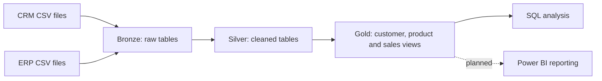

# SQL Sales Data Warehouse

**A SQL Server portfolio project integrating CRM and ERP data into a reporting-ready star schema.**

This project brings customer, product, and sales data from six CSV files into a layered data warehouse. Raw records are loaded into Bronze, cleaned and standardized in Silver, and exposed through Gold views for business analysis.

Developed by [Ilyass Rbaai](https://github.com/Ilyass-rbaai) as a hands-on implementation of the Data With Baraa SQL Data Warehouse tutorial. The repository documents the SQL transformations, source integration, and analytical model.

## Business objective

Create a consistent sales dataset that connects transactions with customer demographics, locations, and product categories. The resulting model supports questions such as:

- How do sales change over time?
- Which products and categories generate the most revenue?
- How are sales distributed across customers and countries?

These are intended analytical uses of the warehouse; a Power BI dashboard is a planned extension.

## Architecture



| Layer | Responsibility | Implementation |
| --- | --- | --- |
| Bronze | Ingest source records with minimal transformation | Six tables loaded using `BULK INSERT` |
| Silver | Clean, standardize, and prepare source data for integration | Six tables populated by `silver.load_silver` |
| Gold | Expose business attributes and sales measures | Two dimension views and one fact view |

Bronze and Silver use full refresh loads: each procedure truncates its target tables before inserting records. Gold consists of logical views over Silver, rather than separately loaded physical tables.

Editable architecture and model diagrams are available in [docs/](docs/).

## Source data

| System | File | Contents |
| --- | --- | --- |
| CRM | `source_crm/cust_info.csv` | Customer identifiers, names, status, and creation dates |
| CRM | `source_crm/prd_info.csv` | Product identifiers, names, costs, lines, and validity dates |
| CRM | `source_crm/sales_details.csv` | Orders, product and customer references, dates, and sales measures |
| ERP | `source_erp/CUST_AZ12.csv` | Customer birth dates and gender |
| ERP | `source_erp/LOC_A101.csv` | Customer locations |
| ERP | `source_erp/PX_CAT_G1V2.csv` | Product categories, subcategories, and maintenance attributes |

The sample datasets originate from the tutorial project and are included for reproducibility.

## Transformations

- Deduplicate CRM customers using `ROW_NUMBER()` and the latest creation date.
- Trim customer names and standardize gender and marital status codes.
- Extract product category identifiers and product numbers from source keys.
- Map product line codes to descriptive values and handle missing costs.
- Calculate product end dates from the next version's start date using `LEAD()`.
- Convert source sales dates and recalculate selected invalid sales amounts and prices.
- Normalize ERP customer identifiers and country codes.
- Replace future birth dates with `NULL`.
- Enrich customers and products by joining CRM and ERP records.
- Expose current product records in the Gold product dimension.

## Analytical model

| View | Purpose | Key / measures |
| --- | --- | --- |
| `gold.dim_customers` | Customer attributes enriched with ERP demographics and location | `customer_key` |
| `gold.dim_products` | Current product attributes enriched with ERP categories | `produt_key` (current script spelling) |
| `gold.fact_sales` | Source sales detail records linked to both dimensions | `customer_key`, `produt_key`, `sales_amount`, `quantity`, `price` |

The fact view preserves source sales detail rows; it does not aggregate orders. Both relationships are logical joins, rather than enforced foreign-key constraints. Unmatched dimension references are retained through `LEFT JOIN` and should be investigated during validation.

Dimension keys are generated with `ROW_NUMBER()` and can change when source data changes. They should not be treated as persistent identifiers across independent refreshes.

## Tools and SQL techniques

- Microsoft SQL Server and SQL Server Management Studio (SSMS)
- T-SQL tables, schemas, views, and stored procedures
- `BULK INSERT`, joins, window functions, conditional transformations, and null handling
- SQL queries for data quality inspection
- diagrams.net / draw.io for architecture and model documentation

## Repository structure

```text
sql-data-warehouse-project/
├── datasets/
│   ├── source_crm/
│   └── source_erp/
├── docs/
│   ├── data_architecture.drawio
│   ├── data_flow.drawio
│   ├── data_integration.drawio
│   └── data_model.drawio
├── scripts/
│   ├── init_database.sql
│   ├── bronze/
│   │   ├── ddl_bronze.sql
│   │   └── proc_load_bronze.sql
│   ├── silver/
│   │   ├── ddl_script.sql
│   │   └── proc_load_silver.sql
│   └── gold/
│       └── ddl_gold.sql
├── tests/
│   ├── quality_checks_silver.sql
│   └── quality_checks_gold.sql
├── .gitignore
├── LICENSE
└── README.md
```

## Run the project

### Prerequisites

Use SQL Server with `TRIM()` support, SSMS, and permissions to create the database and perform bulk imports. The SQL Server service must be able to read the CSV files; paths are resolved on the server running SQL Server.

Clone or download this repository:

```bash
git clone https://github.com/Ilyass-rbaai/sql-data-warehouse-project.git
```

### Configure and execute

1. Update the six CSV paths in `scripts/bronze/proc_load_bronze.sql` to match your dataset location.
2. Before running `scripts/init_database.sql`, correct its database-name mismatch: the `DROP DATABASE` statement must use `DataWeareHouse`, matching the name created by the script.
3. Run the initialization script only against a disposable project database. It is designed to drop and recreate the database, deleting existing data.
4. Select `DataWeareHouse` in SSMS and run the Bronze and Silver table scripts, followed by their procedure scripts.
5. Load both layers in order:

```sql
USE DataWeareHouse;
GO
EXEC bronze.load_bronze;
GO
EXEC silver.load_silver;
GO
```

6. Run `tests/quality_checks_silver.sql`. Inspect each result set: some queries display distinct values or sample records, while anomaly checks identify records requiring investigation.
7. Create the Gold views using `scripts/gold/ddl_gold.sql`. In the current script, execute each `CREATE VIEW` separately, or add `GO` before and after each view definition. SQL Server requires `CREATE VIEW` to start a query batch. Existing views must be dropped or altered before recreating them.
8. Run `tests/quality_checks_gold.sql` and investigate duplicate keys, null keys, or unmatched fact-to-dimension references.

### Example analysis

```sql
SELECT
    YEAR(order_date) AS sales_year,
    MONTH(order_date) AS sales_month,
    SUM(CAST(sales_amount AS BIGINT)) AS total_sales,
    COUNT(DISTINCT order_number) AS total_orders
FROM gold.fact_sales
WHERE order_date IS NOT NULL
GROUP BY YEAR(order_date), MONTH(order_date)
ORDER BY sales_year, sales_month;
```

## Validation and limitations

The repository includes inspection queries for customer keys, text formatting, product costs, sales dates, and sales arithmetic. Gold checks cover dimension key uniqueness and fact-to-dimension connectivity.

The scripts are intended for a learning and portfolio environment. Loads are full refreshes and are not atomic across all tables. Bronze prints caught errors without rethrowing them, so a completed procedure call alone is not proof of a successful load. There is no automated scheduling, incremental loading, or persistent dimension-key management.

Execution results should be recorded after running the pipeline in SQL Server; the presence of validation scripts alone does not establish that every check passes.

## Next improvements

- Standardize database and column names, including `produt_key` and `prroduct_line`.
- Add diagram previews and a data catalog aligned with the actual SQL columns.
- Record source-to-target row counts, test results, and load durations.
- Improve date conversion, error propagation, and numeric precision handling.
- Add SQL analyses for customer behavior, product performance, and sales trends.
- Build a Power BI report with a date dimension and documented measures.

## Author and acknowledgments

**Ilyass Rbaai** — [GitHub profile](https://github.com/Ilyass-rbaai)

Built while following [Data With Baraa's SQL Data Warehouse tutorial](https://www.youtube.com/watch?v=9GVqKuTVANE). The original project and learning materials are available in [DataWithBaraa/sql-data-warehouse-project](https://github.com/DataWithBaraa/sql-data-warehouse-project).

## License

This project includes material from the original MIT-licensed tutorial project. See [LICENSE](LICENSE) for the retained license and copyright notice.
