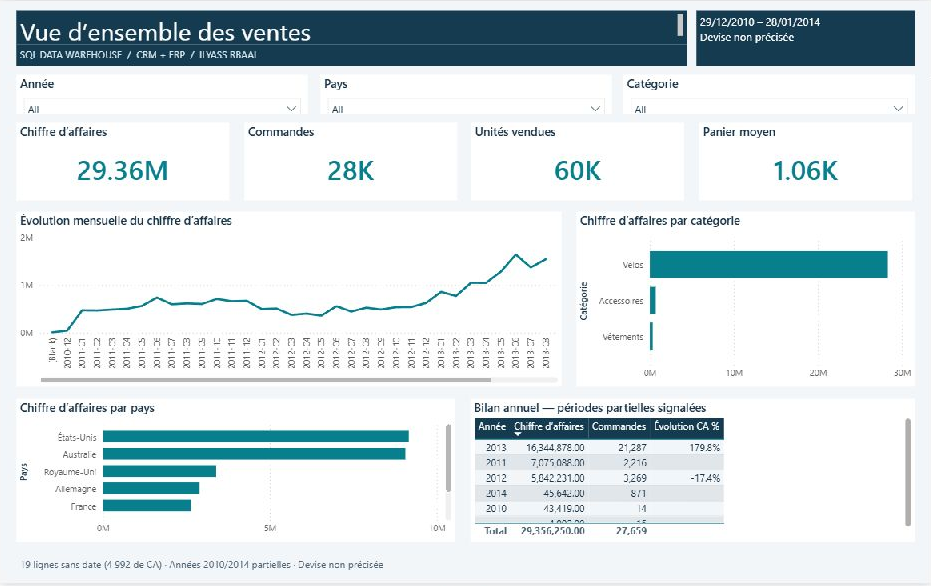
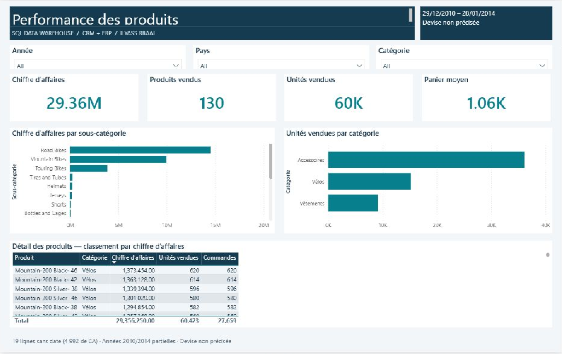
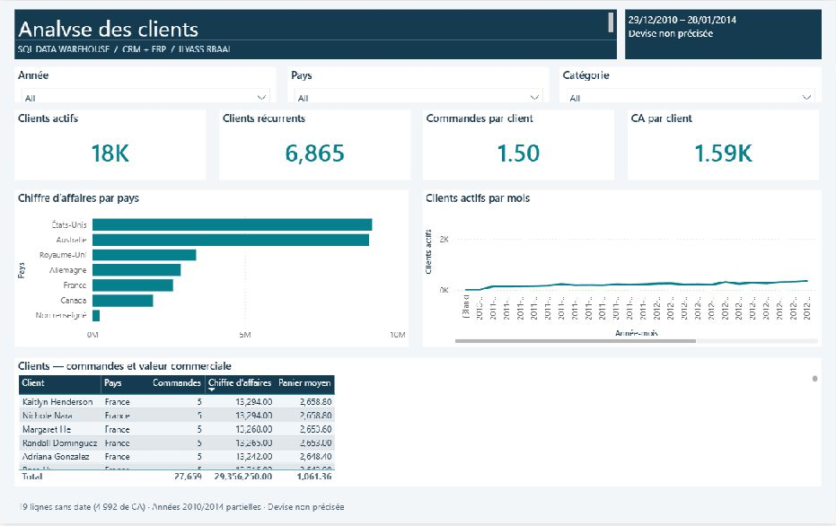

# Analyse des ventes — Power BI

Rapport en français connecté aux trois vues Gold du projet SQL Server, en mode Import. Le projet comprend un modèle en étoile, un calendrier et 16 mesures DAX.

## Ouvrir le rapport

Pour consulter immédiatement les données déjà chargées, ouvrir **`AnalyseVentes.pbix`**. Le fichier conserve les données importées et les trois pages. Utiliser le projet PBIP ci-dessous pour travailler sur les sources versionnées.

1. Démarrer l'instance SQL Server `localhost\SQLEXPRESS`.
2. Vérifier que la base `DataWeareHouse` et les vues `gold.dim_customers`, `gold.dim_products` et `gold.fact_sales` sont chargées.
3. Ouvrir `AnalyseVentes.pbip` avec Power BI Desktop. Conserver les dossiers `.Report` et `.SemanticModel` à côté de ce fichier.
4. Actualiser les données avec votre authentification Windows. Si Power BI demande une authentification ou une décision concernant le certificat du serveur, effectuer cette étape dans l'application.
5. Pour un autre serveur, modifier les trois expressions `Sql.Database` du modèle, ou les paramètres de source dans Power BI Desktop.

Le projet PBIP est éditable et adapté au suivi Git. Les fichiers de cache locaux ne doivent pas être publiés. Une version PBIX peut être enregistrée depuis Power BI Desktop après actualisation.

## Pages

| Page | Contenu |
| --- | --- |
| 01 · Synthèse | Chiffre d'affaires, commandes, unités, panier moyen, évolution mensuelle, catégories, pays et bilan annuel |
| 02 · Produits | Produits vendus, sous-catégories, volumes par catégorie et détail des produits |
| 03 · Clients | Clients actifs et récurrents, fréquence d'achat, CA par client, pays, évolution mensuelle et détail clients |

Chaque page possède des filtres année, pays et catégorie. Les valeurs des pays et des catégories principales sont traduites dans Power Query ; les noms de produits conservent les libellés de la source.

## Modèle

- `Clients[Clé client]` → `Ventes[Clé client]` : relation 1 à plusieurs.
- `Produits[Clé produit]` → `Ventes[Clé produit]` : relation 1 à plusieurs.
- `Calendrier[Date]` → `Ventes[Date commande]` : relation active 1 à plusieurs.
- `Calendrier[Date]` → `Ventes[Date expédition]` : relation inactive, utilisée par la mesure `CA expédié`.
- Sens de filtre unique, depuis les dimensions vers les ventes.
- Les colonnes techniques sont masquées ; les mesures sont regroupées par thème.

Le calendrier couvre les années entières contenant les commandes. `Date` est définie comme clé du calendrier, identifié comme table de temps. Les noms des mois sont français et triés par numéro de mois.

Les noms source `produt_key` et `prroduct_line` sont renommés dans Power Query. Le rapport ne modifie pas les vues SQL existantes.

## Définition des indicateurs

Les formules sont incluses dans le modèle et dans `mesures.dax`.

- **Chiffre d'affaires** : somme de `sales_amount`.
- **Commandes** : nombre distinct de `order_number`.
- **Unités vendues** : somme de `quantity`.
- **Panier moyen** : chiffre d'affaires / commandes.
- **Clients actifs** : clients distincts présents dans les ventes filtrées.
- **Clients récurrents** : clients ayant plusieurs commandes dans la sélection courante.
- **Taux de récurrence** : clients récurrents / clients actifs.
- **Évolution CA %** : variation par rapport aux mêmes dates de l'année précédente, affichée pour les années comparables uniquement. Le total multiannuel reste vide.

Le taux de récurrence décrit la période et les filtres sélectionnés ; il ne constitue pas une mesure de rétention entre cohortes.

## Précautions d'interprétation

- 19 lignes n'ont pas de date de commande, représentant 4 992 de CA. Elles restent incluses dans le total sans filtre de date et sont exclues des périodes datées. Les mesures `Lignes sans date` et `CA sans date` permettent de les suivre.
- La devise n'est pas renseignée dans les sources ; aucun symbole monétaire n'est ajouté.
- Les données couvrent le 29 décembre 2010 au 28 janvier 2014. Les années 2010 et 2014 sont partielles : éviter les comparaisons de croissance avec des années complètes.
- Aucun objectif commercial ni historique des coûts de vente n'est fourni. Le rapport n'invente ni taux d'atteinte d'objectif ni marge historique.
- Le coût produit actuel n'est pas utilisé pour calculer un bénéfice historique.
- Les clés des vues Gold sont calculées avec `ROW_NUMBER()` : actualiser ensemble les trois tables après un rechargement SQL.

## Vérification SQL initiale

Contrôle effectué le 12 octobre 2026 sur l'instance fournie :

| Indicateur | Valeur SQL |
| --- | ---: |
| Lignes de vente | 60 398 |
| Clients dans la dimension | 18 484 |
| Produits actuels dans la dimension | 295 |
| Commandes distinctes | 27 659 |
| Unités vendues | 60 423 |
| Chiffre d'affaires | 29 356 250 |
| Ventes sans clé client ou produit | 0 |

Ces contrôles concernent SQL. La vérification du rendu et de l'actualisation Power BI est documentée séparément dans `validation.md`.

## Aperçus

